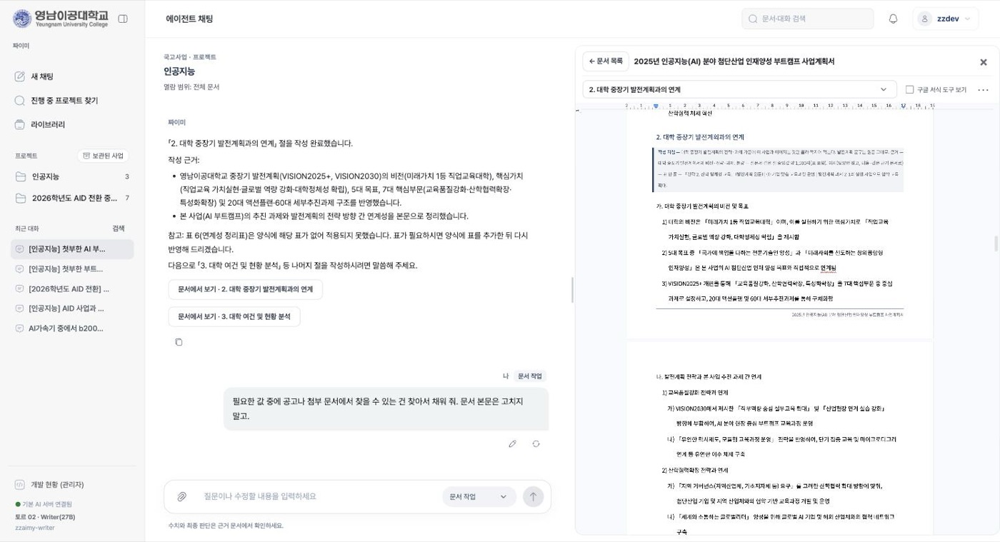
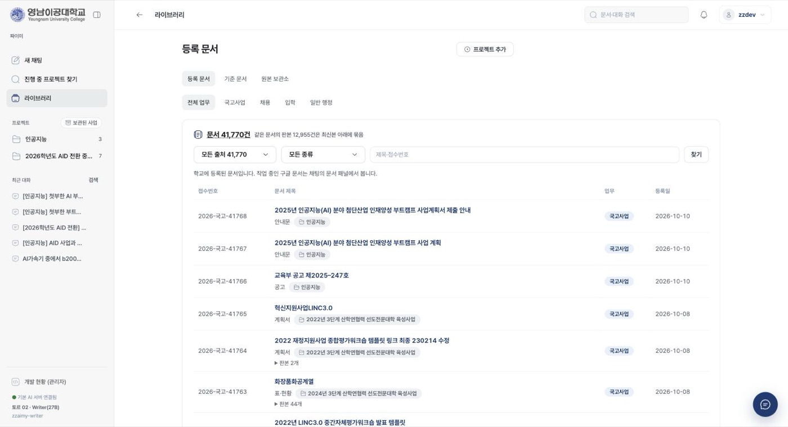
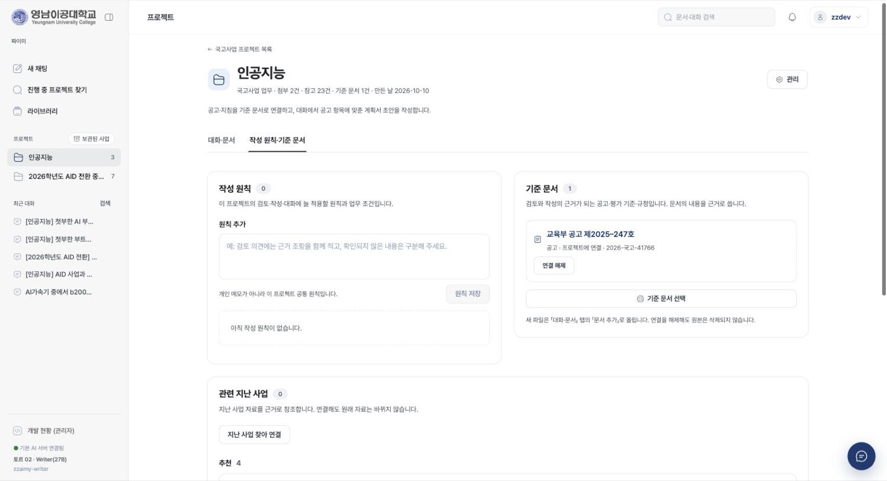
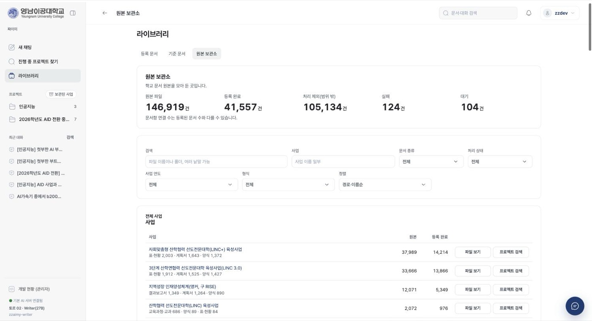
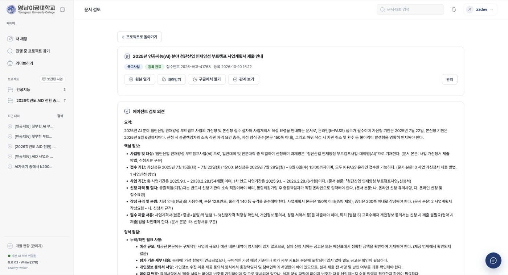

# AURA

교내 행정 업무 자동화를 위한 sLLM 모델 개발 및 행정 자동화 에이전트. 온프레미스에서 OCR로 학교 문서를 데이터화하고, RAG와 파인튜닝 모델로 문서 업무를 돕는다.

AURA는 대학 행정 부서를 위한 문서 업무 플랫폼이다. 국고사업 공고·계획서·결과보고서와 교내 규정을 읽어
질문에 근거와 함께 답하고, 사업계획서 초안을 양식에 맞춰 절 단위로 써 준다. 모든 모델은 교내 장비에서
돌아가므로 문서가 외부 AI 서비스로 나가지 않는다. 초안에 들어가는 수치는 보유 문서에서 찾은 값만 쓰고, 근거가
없는 값은 가려서 담당자에게 확인을 청한다. 완성본은 원래 받은 한글(HWPX) 서식을 그대로 둔 채 내용만 채워 낸다.

영남이공대학교 2026년 2학기 캡스톤 프로젝트로 개발하고 있다. 산출물은 담당자가 검토해 완성하는 초안이다.

## 주요 기능

- 문서 반입: PDF·HWP·HWPX·DOCX·XLSX·PPTX·이미지에서 본문·표·그림을 뽑는다. 스캔 문서는 OCR로 읽고, 서류 갈래와 소속 사업을 분류한다.
- 근거 검색: 어휘 검색과 의미 검색을 합쳐 찾고, 규정 문서는 리랭커로 한 번 더 정렬한다. 답마다 원문 출처를 단다.
- 열람 권한: 부서·역할별 검색 범위를 검색 단계에서 적용한다. 볼 수 없는 문서는 근거로도 쓰이지 않는다.
- 지식 그래프: 사업 → 연차 → 문서 → 절의 관계를 근거가 확인된 것만 잇고, 화면에서 탐색한다. 온톨로지는 OWL·RDF로 내보내고 SHACL로 검사한다.
- 문서 작업 에이전트: 대화로 요청하면 Writer 모델이 할 일을 스스로 골라 자료 찾기, 양식 고르기, 절 쓰기, 검토, 내보내기를 진행한다. 자료로 채울 수 없는 값은 담당자에게 묻는다.
- 수치 근거 대조: 초안의 수치를 근거와 대조해 근거에 없는 값을 「○○」로 가리고 확인할 값으로 알린다.
- 서식 보존 산출: Google Docs 작업본에서 함께 고친 내용을 원본 HWPX 서식에 채워 한글 파일로 내보낸다.
- 답변 모드: 문서 근거 답변(기본), 웹 검색 결과 기반 답변, 모델 자체 답변 가운데 고른다.
- 학습 데이터 관리: 실문서에서 만든 학습 후보를 사람이 검수·승인한 것만 학습에 쓴다.

## 화면


문서 작업 에이전트. 대화로 요청하면 근거를 찾아 사업계획서의 절을 쓰고, 오른쪽 패널에서 Google Docs 작업본을 함께 고친다.


등록 문서. 반입한 문서를 업무·종류·사업별로 찾고, 같은 문서의 판본은 최신본 아래에 묶는다.


프로젝트. 공고·지침을 기준 문서로 잇고, 관련 지난 사업을 근거 낱말과 함께 추천한다.


원본 보관소. 학교 원본 파일을 사업 → 연도 → 문서 종류로 훑고 처리 상태를 확인한다.


문서 검토. 반입한 문서마다 요약·핵심 정보·형식 점검을 원문 근거와 함께 보인다.

## 동작 방식

```
[반입]      PDF · HWP/HWPX · 오피스 문서 · 이미지
   │
   ▼
[추출]      글자층 직독 · MinerU OCR · Writer 이미지 판독 · kordoc
   │
   ▼
[저장]      PostgreSQL: 문서·조각·권한 · 어휘 색인 · pgvector · 지식 그래프
   │
   ▼
[검색]      열람 범위 필터 → 어휘 + 의미 검색 RRF 융합 → 리랭킹(규정)
   │
   ▼
[작업]      문서 작업 에이전트: Writer가 도구를 고르고 코드가 실행·검증
   │
   ▼
[산출]      출처가 붙은 답변 · Google Docs 작업본 · 원본 서식 HWPX
```

문서 작업 에이전트는 한 걸음씩 일한다.

1. Writer 모델이 현재 상태(요청, 최근 대화, 프로젝트 문서 목록, 작업본의 절 목록과 빈 절, 아직 받지 못한 값)를 읽는다.
2. 다음에 할 일을 도구 하나로 고른다. 도구는 근거 찾기, 절 읽기, 문서 만들기, 절 쓰기·다시 쓰기, 검토, 값 기억하기, 한글 내보내기, 담당자에게 묻기, 마무리다.
3. 코드가 그 도구를 실행한다. 검색은 요청한 사람의 열람 범위 안에서만 하고, 쓴 절은 수치 대조와 품질 검사를 거쳐 작업본에 들어간다.
4. 실행 결과를 다음 걸음의 입력으로 돌려주고, 끝날 때까지 되풀이한다.

걸음 수와 쓰기 횟수에는 상한이 있고, 되돌리기 어려운 작업(다시 쓰기, 내보내기 등)은 요청에 그 뜻이 있을 때만 한다.
모델 서버가 응답하지 않으면 규칙 기반 경로로 처리한다. 판단은 모델이, 권한·수치 검증·양식 모양은 코드가 맡는 구조다.

## 모델

| 모델 | 베이스 | 역할 | 상태 |
|---|---|---|---|
| ZZAIMY-Embed | KURE-v1 | 의미 검색 | v2 운영 |
| ZZAIMY-Rerank | bge-reranker-v2-m3 | 후보 재정렬 | v1 운영 |
| ZZAIMY-Writer | Qwen3.8-27B | 검토·작성·판독 | 베이스 운영 |
| ZZAIMY-Extract | Qwen3.8-27B | 실적 추출 | 예정 |

Writer는 검토, 초안 작성, 그림 판독, 에이전트 판단을 모두 맡는다. 지금은 베이스 모델로 운영하며 도메인 학습용
데이터를 검수하고 있다. Extract는 Writer와 같은 모델에 구조화 출력을 강제해 실적 정보를 뽑는다.

베이스는 모두 Apache 2.0·MIT 라이선스의 오픈웨이트 모델이다. 사실과 수치는 검색으로 공급하고, 모델에는 맥락을 파악해 근거를
골라 쓰는 능력만 학습시킨다. 새 모델은 결정 기록과 같은 입력의 비교 측정을 거쳐서만 들인다.
학습 계획은 [모델 개발 계획](docs/model-plan.md), 학습본 성능은 [모델 카드](docs/model-cards/)에 있다.

## 기술 구성

- 웹 플랫폼: Python 3.12, FastAPI, Jinja2, PostgreSQL
- 검색: PostgreSQL 전문 색인, Kiwi 형태소 분석, pgvector(HNSW), RRF 융합
- 지식 그래프: PostgreSQL 테이블, rdflib·pySHACL(OWL·RDF 내보내기와 검사), Cytoscape.js(탐색 화면)
- 문서 추출: pypdf(디지털 PDF 글자층), MinerU(스캔 PDF), kordoc(한글·docx·xlsx), python-docx·openpyxl·python-pptx, LibreOffice(옛 오피스 형식 변환)
- 문서 작성: Google Docs·Drive API(작업본), 자체 HWPX 서식 채우기
- 모델 서빙: vLLM, Writer 27B NVFP4 양자화(NVIDIA Jetson AGX Thor 2대), 임베딩·리랭커 서비스
- 학습: LLaMA-Factory, sentence-transformers, Label Studio(검수)

## 저장소 구조

```
src/zzaimy/
  app/          웹 화면·API·계정·검색·문서 작업 에이전트
  ingest/       문서 추출, 한글·오피스 변환, HWPX 서식 채우기, 개인정보 인식
  graph/        지식 그래프와 온톨로지
  verify/       수치 근거 대조, 배점 반영 확인, 예산 검산
  dataset/      학습 후보 생성·검수·승인
  generate/     모델 연결 설정
  eval/         검색 평가
  export/       학습 산출물 반출 묶음
scripts/        반입·색인·측정·학습·서빙·배포 도구(번호 순)
configs/        서빙·학습 설정
tests/          회귀 테스트
docs/           설계 문서, 결정 기록(ADR), 측정 보고서, 모델 카드
research/       착수 단계 기술 조사(참고용)
```

## 시작하기

Python 3.12가 필요하다. 저장소 루트에서 실행한다.

```bash
python3.12 -m venv .venv
.venv/bin/pip install -e ".[app,postgres,dev]"
cp .env.example .env.local
set -a; . ./.env.local; set +a; .venv/bin/python -m zzaimy.app.main
```

브라우저에서 `http://127.0.0.1:8800`을 연다. 기본은 로컬 전용 접속이고, 모델 서버 주소(`VLLM_BASE_URL`)와
검색 모델 서비스 주소(`ZZAIMY_EMBED_URL`, `ZZAIMY_RERANK_URL`)는 `.env.local`에서 지정한다.
`ZZAIMY_DATABASE_URL`이 없으면 시험용 SQLite로 동작한다. 스캔 PDF 판독까지 쓰려면 `".[parsers]"`를 더 설치한다.

테스트는 다음 한 줄로 돌린다.

```bash
.venv/bin/python -m pytest -q
```

운영 서버 구성, 배포, 모델 서빙 절차는 [인수인계 문서](docs/HANDOFF.md)에 있다.

## 보안과 데이터 처리

- 실제 문서, 처리 결과, 색인, 비밀값은 저장소에 넣지 않는다. 데이터는 `ZZAIMY_DATA_DIR` 아래에만 둔다.
- 모델 추론은 모두 교내 장비에서 한다. 외부 AI API로 문서를 보내는 경로는 없다.
- 작업본은 학교 Google Workspace 계정의 Docs에 두며, 연결할 수 있는 계정 도메인을 제한한다.
- 외부로 나가는 요청은 담당자가 웹 검색 모드를 켠 질문의 검색어뿐이다. 문서·첨부·교내 자료는 보내지 않고, 민감 정보가 든 질문은 막는다.
- 열람 권한은 검색 단계에서 거른다. 문서마다 부서와 열람 등급(전체 공개, 부서 제한, 담당자 한정)을 붙이고, 학생 계정은 학생에게 공개한 규정만 검색한다.
- 내부 문서의 개인정보 마스킹(주민등록번호, 전화번호, 성명 등 8종)은 관리자 설정으로 켜고 끈다. 학습 데이터는 이 설정과 별개로 개인정보 검수를 통과해야 반출된다.
- 외부 접속을 열려면 비밀번호와 TLS 인증서가 모두 있어야 한다. 없으면 서버가 `127.0.0.1`에만 묶인다.

## 문서

- [프로젝트 브리프](PROJECT_BRIEF.md): 목표, 범위, 설계 원칙
- [시스템 설계](docs/architecture.md): 데이터 흐름과 검색·생성·검증 구조
- [문서 작업 흐름](docs/document-work-flow.md): 문서 세트 접수부터 한글 산출까지
- [문서 안내](docs/README.md): 설계 문서, 측정 보고서, 결정 기록 전체 목록

## 프로젝트 상태

반입·검색·답변과 문서 작성·한글 산출 기능을 교내 서버에서 시범 운영하고 있다. Writer와 Extract의 도메인 학습은
베이스라인 측정과 학습 데이터 검수 단계에 있다. 단계별 진행은 [프로젝트 브리프](PROJECT_BRIEF.md)의 산출물 표를 따른다.
