# AURA

대학 행정 문서 업무를 돕는 온프레미스 에이전트 플랫폼입니다. 학교 문서를 읽어 근거와 함께 답하고, 사업계획서 같은 한글 문서의 초안을 양식에 맞춰 함께 씁니다.

AURA는 국고사업 공고·계획서·결과보고서와 교내 규정을 모아 검색할 수 있는 자료로 바꿉니다. 담당자가 대화로 요청하면 에이전트가 근거를 찾아 절을 쓰고, 담당자는 같은 화면의 한글 웹 기안기에서 바로 고칩니다. 모든 모델은 교내 장비에서 돌아가므로 문서가 외부 AI 서비스로 나가지 않습니다.

초안에 들어가는 수치는 보유 문서에서 찾은 값만 씁니다. 근거가 없는 값은 비워 두고 담당자에게 확인을 청합니다. 산출물은 담당자가 검토해 완성하는 초안입니다.

영남이공대학교 2026년 2학기 캡스톤 프로젝트로 개발하고 있습니다.

## 주요 기능

아래 화면은 모두 로컬 시험 환경에서 지어낸 부서·사람·사업으로 찍었습니다(2026-10-24). 실제 학교 문서나 개인 정보는 들어 있지 않습니다.

### 대화로 쓰는 한글 문서

채팅에서 요청하면 문서 작업 에이전트가 근거를 찾고, 양식을 고르고, 절을 쓰고, 검토까지 진행합니다. 오른쪽 문서 창에는 한글 웹 기안기가 열려 있어 에이전트가 쓰는 자리가 「AURA 작성 중」으로 표시되고, 쓴 내용은 바로 화면에 들어옵니다.

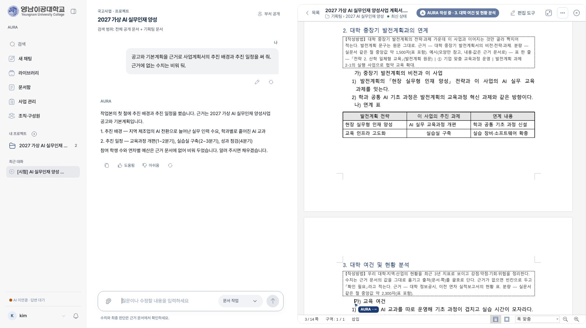

### 질문 방식

입력줄에서 「RAG」(내 계정이 볼 수 있는 교내 문서를 근거로)와 「일반」(모델이 아는 범위에서 바로)을 고릅니다. 일반 답에서 모델이 확인이 필요하다고 보면 인터넷 검색을 권하고, 밖으로는 담당자가 쓴 질문 낱말만 나갑니다. 답변 깊이는 「꼼꼼하게」(생각을 거쳐 넓게 확인, 기본)와 「빠르게」 두 단계이고, 어느 쪽이든 대화 맥락은 작업 메모와 최근 대화로 이어 받습니다. Writer 는 문맥 256K 로 서빙합니다.

### 같은 문서를 여럿이 함께

한글 웹 기안기에서 여러 사람이 한 문서를 동시에 고칩니다. 누가 어느 칸을 쓰는 중인지 이름표와 형광 표시로 보이고, 고친 글은 다른 사람 화면에 바로 들어갑니다. 위쪽 사람 목록에서 이름을 누르면 그 사람이 쓰는 자리로 옮겨 갑니다. AURA 에이전트가 쓰는 자리는 「AURA · 요청한 사람」으로 표시됩니다. 수백 쪽 문서에서도 바뀐 부분만 주고받아 지연이 거의 없습니다.

### 한글 문서함

부서 폴더와 내 폴더에 한글 문서를 두고 기안기로 엽니다. 누가 언제 고쳤는지, 지금 누가 편집 중인지가 목록에 보입니다. 지난 문서에서 모은 양식은 어디서나 쓰는 공통 양식과 사업별 지난 사업 문서로 나눠 둡니다.

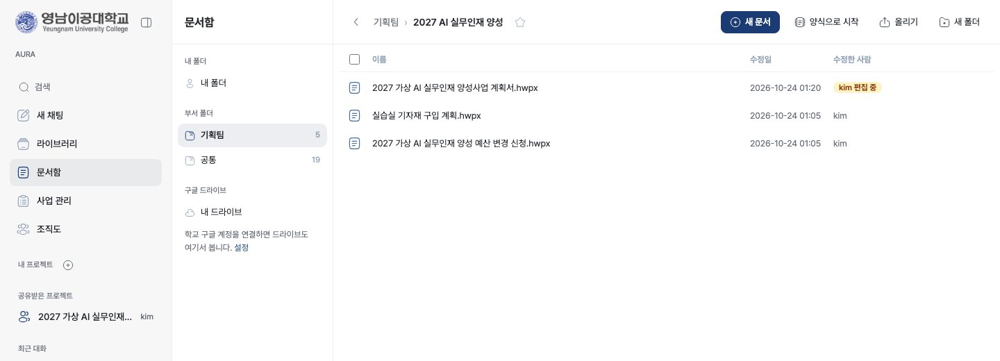

### 라이브러리와 프로젝트

반입한 문서는 서류 갈래·사업·부서별로 정리되고, 같은 문서의 판본은 하나로 묶입니다. 프로젝트는 공고·지침을 기준 문서로 잇고, 그 사업의 대화와 작업 문서를 한곳에 모읍니다.

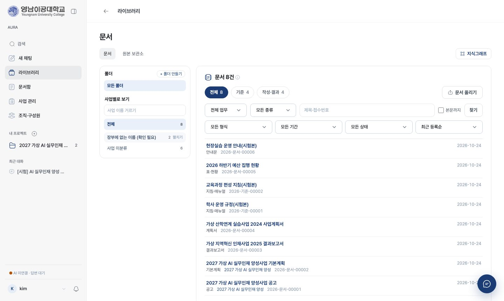

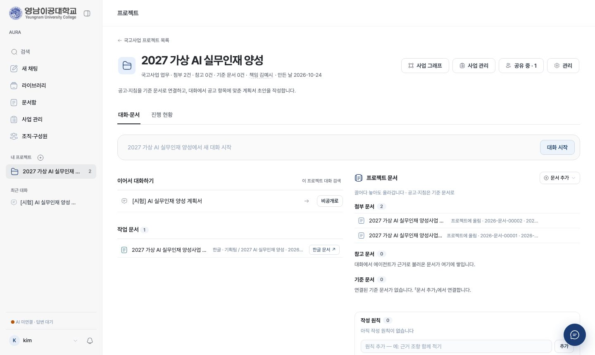

### 조직 관리와 사업 관리

조직 관리 한 화면에서 왼쪽 부서 트리(여러 단계, 찾기·접기·끌어 옮기기)를 고르고 오른쪽에서 구성원·부서 설정·계정을 관리합니다. 교직원 등급(일반·행정 담당자·사업 책임자·총괄 책임자)에 따라 할 수 있는 일이 나뉩니다. 사업 관리 화면에서는 교내 사업을 연도별로 보고 사업마다 책임자와 행정 담당자를 정합니다.

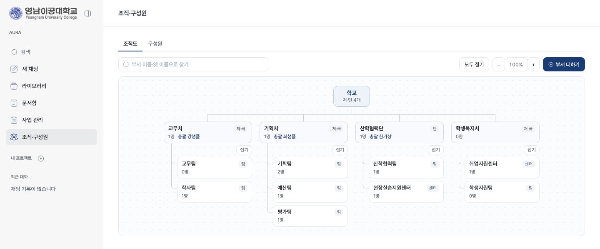

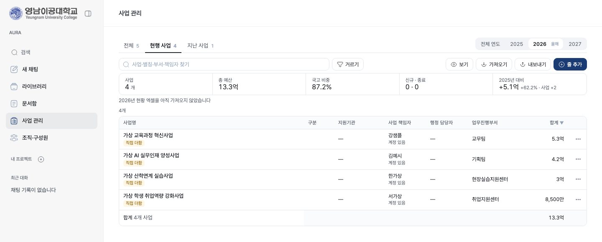

관리자는 조직 관리의 「전체 사용자」에서 계정의 역할과 부서를 정하고, 개발 현황 화면에서 장비 구성과 기능별 진행 상황을 봅니다.

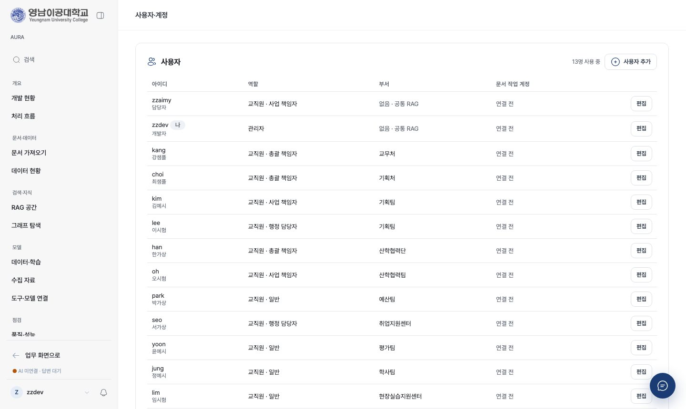

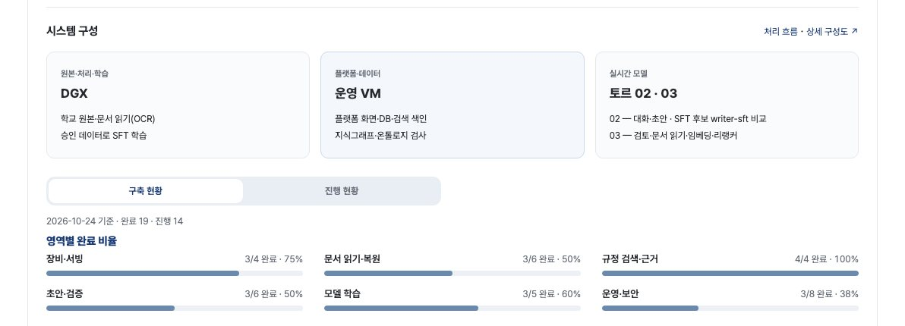

## 동작 방식

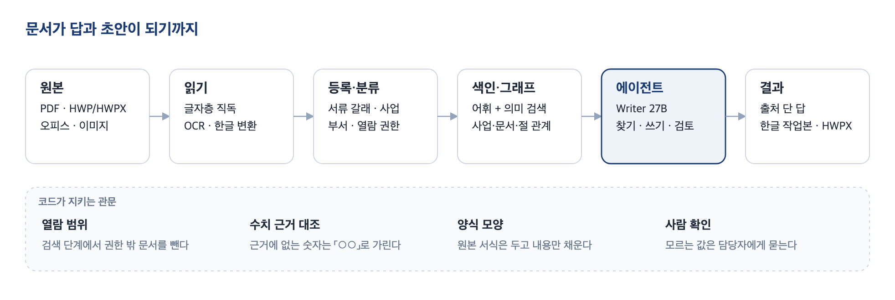

문서는 읽기, 등록·분류, 색인을 거쳐 검색할 수 있는 자료가 됩니다. 스캔 문서는 OCR로 읽고, 한글 파일은 자체 변환기로 본문과 표를 뽑습니다. 검색은 어휘 검색과 의미 검색을 합쳐 쓰고, 사업 → 연차 → 문서 → 절의 관계는 지식 그래프로 따로 둡니다.

문서 작업 에이전트는 한 단계씩 일합니다. Writer 모델이 지금 상태(요청, 최근 대화, 작업본의 빈 절, 아직 받지 못한 값)를 읽고 다음에 할 일을 도구 하나로 고르면, 코드가 그 도구를 실행하고 결과를 다음 단계에 돌려줍니다. 판단은 모델이 하고, 열람 권한·수치 대조·양식 모양은 코드가 지킵니다.

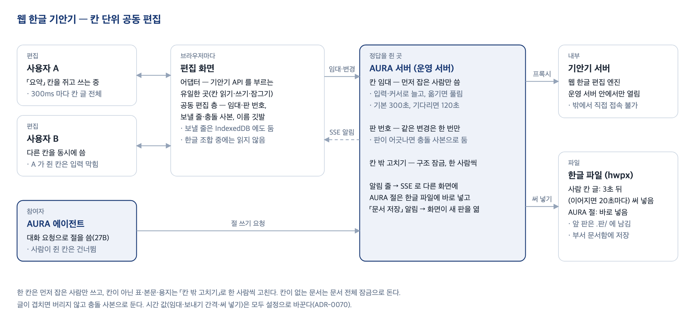

기안기 서버는 운영 서버 안에서만 열려 있고, 브라우저는 AURA를 거쳐서만 기안기에 닿습니다. 편집 잠금과 저장 판 기록도 AURA가 맡습니다.

## 구성

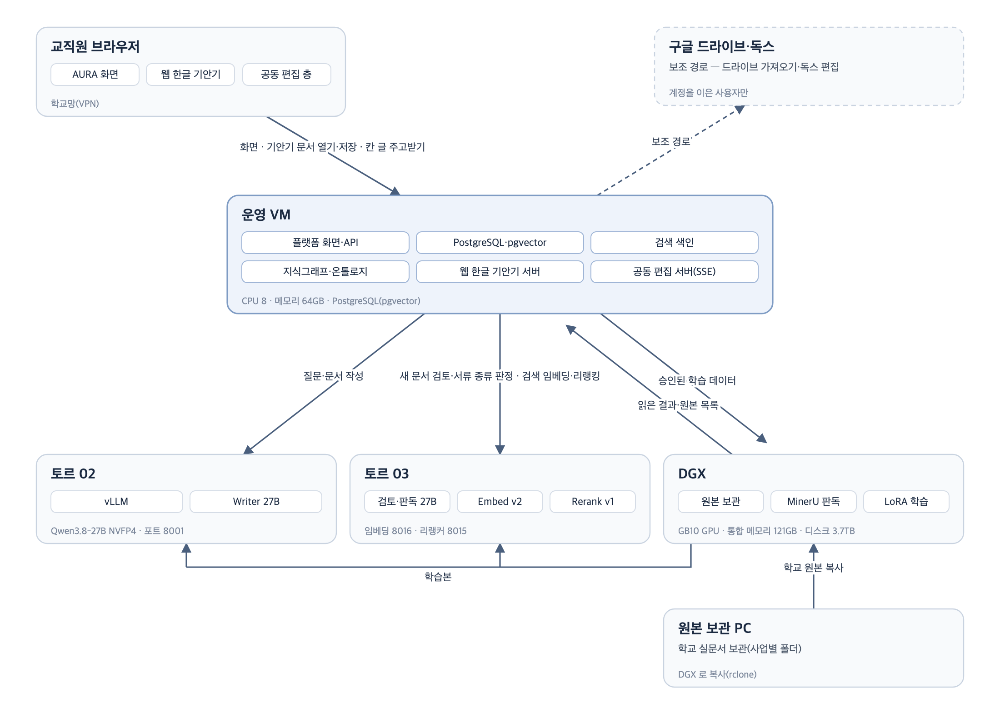

| 장비 | 하는 일 |
|---|---|
| 운영 서버 (VM) | 웹 화면, 검색 색인, 지식 그래프, 한글 기안기. 상시 가동 |
| 젯슨 AGX 토르 02 | Writer 27B 서빙. 대화·초안처럼 사람이 기다리는 일 |
| 젯슨 AGX 토르 03 | Writer 27B 서빙. 반입 검토·이미지 판독, 임베딩·리랭커 |
| DGX | 학교 원본 보관, 문서 일괄 읽기, 모델 학습 |

| 모델 | 베이스 | 역할 | 상태 |
|---|---|---|---|
| ZZAIMY-Embed | KURE-v1 | 의미 검색 | v2 운영 |
| ZZAIMY-Rerank | bge-reranker-v2-m3 | 검색 후보 재정렬 | v1 운영 |
| ZZAIMY-Writer | Qwen3.8-27B | 답·문서 작성 에이전트, 검토, 이미지 판독 | 베이스 운영, 학습 데이터 보강 중 |
| ZZAIMY-Extract | Qwen3.8-27B | 사업 정보·성과지표 추출 | Writer와 같은 모델로 운영 |

Writer는 지금 베이스 모델로 운영합니다. 실문서로 만든 첫 학습본은 학습 꼴 시험에서는 나아졌지만 학습셋의 답 틀이 문서 작업 에이전트의 단계 출력에 섞여 운영에 넣지 않았고, 플랫폼이 실제로 보내는 요청 꼴로 학습 데이터를 다시 만들고 있습니다. 결과 수치는 [모델 카드](docs/model-cards/)에 적습니다. 사실과 수치는 검색으로 공급하고, 모델에는 맥락을 파악해 근거를 골라 쓰는 능력만 학습시킵니다.

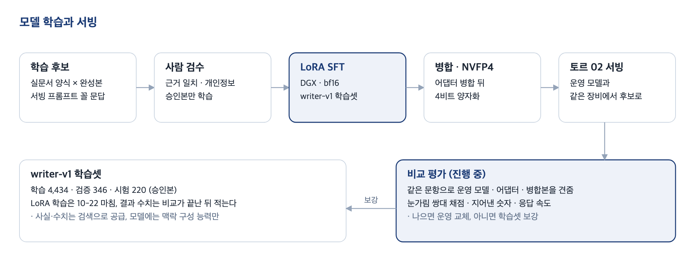

베이스는 모두 Apache 2.0·MIT 라이선스의 오픈웨이트 모델입니다. 새 모델은 결정 기록과 같은 입력의 비교 측정을 거쳐서만 들입니다. 학습 계획은 [모델 개발 계획](docs/model-plan.md)에 있습니다.

기술 구성은 다음과 같습니다.

- 웹 플랫폼: Python 3.12, FastAPI, Jinja2, PostgreSQL
- 검색: PostgreSQL 전문 색인, Kiwi 형태소 분석, pgvector(HNSW), RRF 융합
- 지식 그래프: PostgreSQL 테이블, rdflib·pySHACL(OWL·RDF 내보내기와 검사), Cytoscape.js
- 문서 읽기: pypdf, MinerU(스캔 PDF), kordoc(한글·오피스), LibreOffice(옛 형식 변환)
- 문서 작성: 한글 웹 기안기, 자체 HWPX 서식 채우기, Google Docs·Drive API(작업본, 선택)
- 모델: vLLM(Writer 27B, NVFP4), TRL·PEFT(LoRA), sentence-transformers, Label Studio(학습 데이터 검수)

## 저장소 구조

```
src/zzaimy/
  app/          웹 화면·API·계정·검색·문서 작업 에이전트·한글 기안기 연동
  ingest/       문서 읽기, 한글·오피스 변환, HWPX 서식 채우기, 개인정보 인식
  graph/        지식 그래프와 온톨로지
  verify/       수치 근거 대조, 배점 반영 확인, 예산 검산
  dataset/      학습 후보 생성·검수·승인
  generate/     모델 연결 설정
  eval/         검색 평가
  export/       학습 산출물 반출 묶음
scripts/        반입·색인·측정·학습·서빙·배포 도구(번호 순)
configs/        서빙·학습 설정
tests/          회귀 테스트
docs/           설계 문서, 결정 기록, 측정 보고서, 모델 카드
research/       착수 단계 기술 조사
```

## 문서 안내

- 핵심: [프로젝트 브리프](PROJECT_BRIEF.md), [시스템 설계](docs/architecture.md), [문서 작업 흐름](docs/document-work-flow.md), [모델 개발 계획](docs/model-plan.md)
- 결정: [결정 기록(ADR)](docs/decisions/README.md)
- 기록: [현재 작업](docs/dev-now.md), [기록 자료 색인](docs/notes/README.md), [주간 보고](docs/weekly/), [전체 문서 목록](docs/README.md)
- 논문: [캡스톤 논문 원고](docs/paper/논문/README.md) — 장별 원고와 그림·표 목록. 같은 내용을 플랫폼의 웹 한글 기안기 문서로도 쓴다

## 프로젝트 상태

반입·검색·답변, 문서 작성, 한글 문서함과 웹 기안기를 교내 서버에서 시범 운영하고 있습니다. Writer 도메인 학습은 첫 학습본 비교를 마치고 학습 데이터를 보강하는 단계입니다. 단계별 진행은 [프로젝트 브리프](PROJECT_BRIEF.md)의 산출물 표를 따릅니다.
