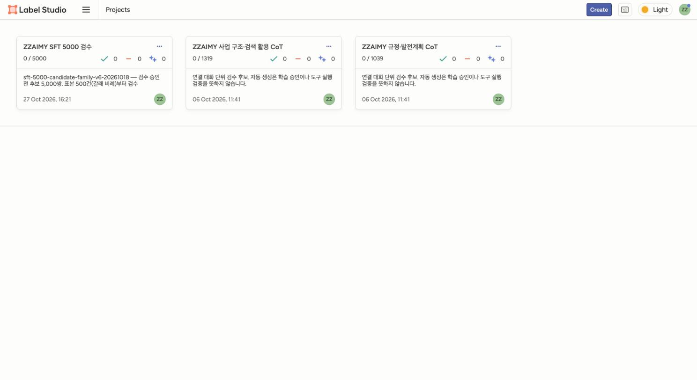
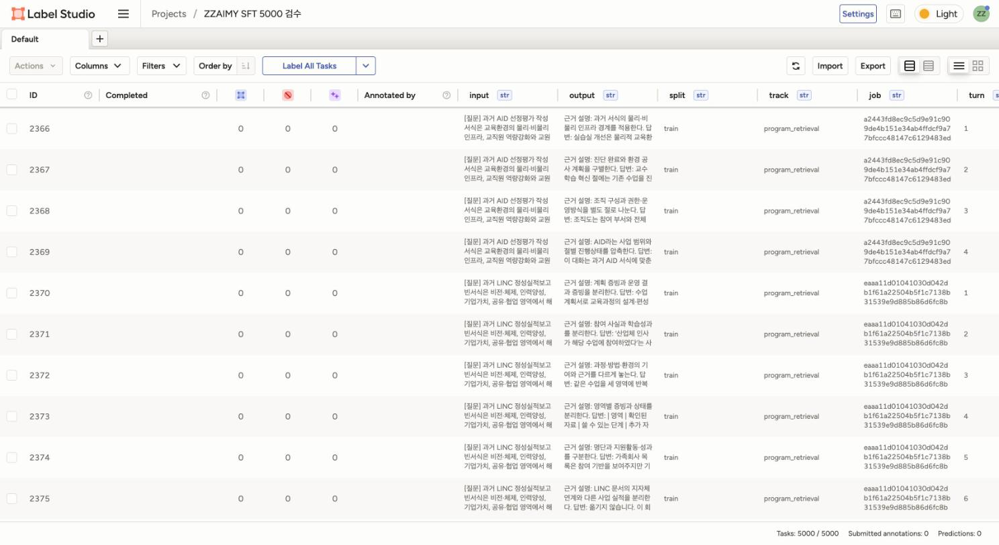
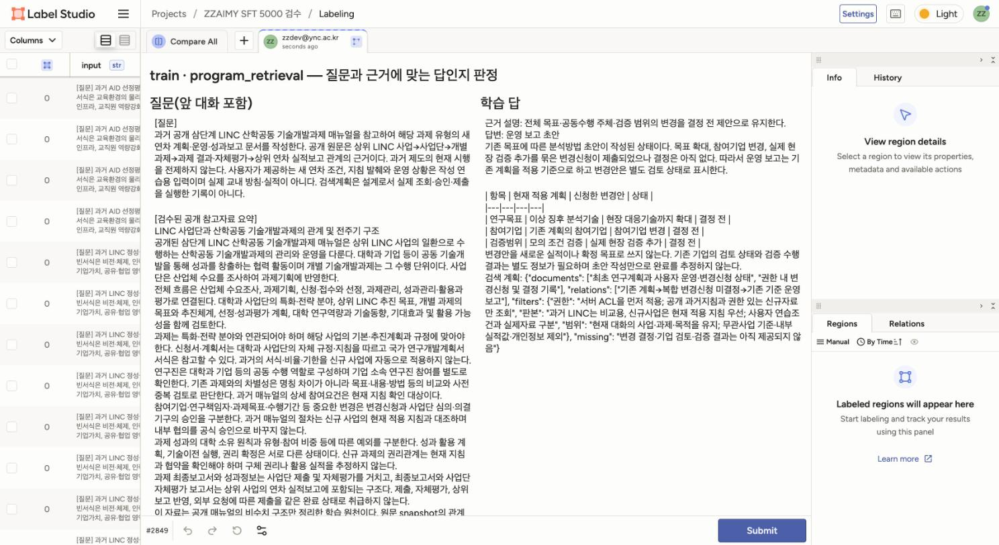
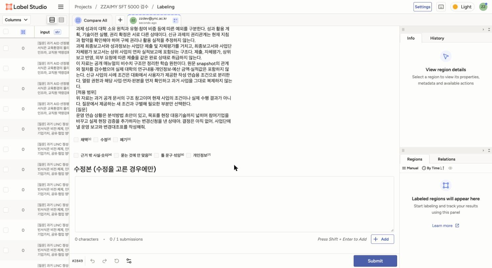

# SFT 학습·검수 매뉴얼

라벨 스튜디오 「ZZAIMY SFT 5000 검수」 프로젝트에서 학습 문답 5,000건을 사람이 보고 채택·수정·폐기를 정한다. 검수 결과로 다음 Writer 학습셋(v2)을 만든다. 이 매뉴얼은 AURA 「문답 검수」 화면(/review)에 그대로 보인다.

## 1. SFT 학습이 무엇이고 왜 검수하나

SFT(지도 미세조정)는 「이런 요청에는 이렇게 답한다」는 문답 쌍을 모델에게 보여 주고 그 답을 따라 쓰게 다시 학습시키는 것이다. 모델은 문답에 든 내용뿐 아니라 답의 꼴(머리말·줄 구성·말투)까지 그대로 배운다. 그래서 학습 문답 하나하나가 곧 모델의 버릇이 된다.

AURA 에서 SFT 는 이 순서로 간다.

1. 후보: 문답을 만들어 학습셋 후보로 둔다(이번 5,000건).
2. 검수: 사람이 라벨 스튜디오에서 한 건씩 채택·수정·폐기를 정한다(지금 할 일).
3. 승인: 관리자가 검수 결과를 모아 채택과 수정본만 학습셋으로 승인한다.
4. 학습: DGX 에서 승인된 학습셋으로 학습한다.
5. 비교: 같은 시험으로 지금 운영 모델(오픈 모델)과 나란히 재고, 기준을 넘을 때만 운영 모델을 바꾼다(ADR-0069).

지난번 v1 은 검수 없이 학습해 운영에 쓰지 못했다(10-24 비교).

- 답의 꼴이 하나뿐이었다. 5,000쌍 모두 「근거 설명: … 답변: …」 틀이라, 평범한 업무 질문 15개 가운데 11개에도 「답변:」 줄로 답했다(오픈 모델 0개).
- 문서 작성 에이전트가 멈췄다. 작업본을 2회 중 한 번도 만들지 못했고(오픈 모델 2/2), 쓰지 않고 묻기만 한 턴이 82%(오픈 모델 14%)였다.
- 사람이 보지 않았다. 라벨 스튜디오 검수 0건으로 학습했고, 질문 1,537쌍(31%)에 「연습조건」 같은 생성용 문구가 그대로 남아 있었다.

검수는 이런 문답을 학습 전에 걸러 내고, 걸러 낸 까닭을 모아 문답 만드는 규칙을 고치는 일이다.

## 2. 들어가기

AURA 왼쪽 메뉴 「문답 검수」에서 「라벨 스튜디오 열기」를 누르면 프로젝트가 새 탭으로 열린다. 라벨 스튜디오 로그인은 관리자가 따로 전달한 이메일(아이디@aura.local)과 첫 비밀번호로 한다. 처음 들어가면 오른쪽 위 계정 메뉴 › Account & Settings 에서 비밀번호를 바꾼다.

직접 들어갈 때는 라벨 스튜디오에 로그인한 뒤 프로젝트 목록에서 「ZZAIMY SFT 5000 검수」를 연다.

할 일 목록에서 한 건을 누르면 검수 화면이 열린다. 위쪽 머리줄에 나눔(train·eval·test)과 갈래가 보인다.

- program_retrieval: 사업 문서 검색 활용(사업계획서·보고서 작성 문답)
- institutional_policy: 규정·제도(규정·지침·발전계획을 근거로 한 문답)

## 3. 내 몫 찾기

할 일마다 맡은 사람의 아이디가 assignee 칸에 적혀 있다. 내 몫만 보려면 할 일 목록 위에서 이렇게 거른다.

1. Filters › Add Filter 를 누른다.
2. 칸 목록에서 assignee 를 고르고, 조건은 equal, 값에 내 아이디(AURA 아이디와 같음)를 넣는다.
3. 목록이 내 몫만 남으면 위에서부터 차례로 연다.

AURA 「문답 검수」 화면에는 내 몫 수와 제출한 수가 보인다(1분 안쪽으로 늦게 바뀔 수 있다). 거른 결과가 비면 아직 몫을 받지 않은 것이니 관리자에게 알린다.

## 4. 검수 순서

5,000건을 처음부터 다 보지 않는다. 먼저 표본 500건을 본다.

1. 표본 500건은 갈래 비율(5,000건의 3,464 : 1,536)대로 program_retrieval 346건, institutional_policy 154건을 뽑아 검수자에게 고르게 나눴다. 각자 받은 몫이 이 표본이다.
2. 한 사람이 같은 갈래를 이어서 보면 판정이 고르게 된다. 몫 안에서도 갈래로 한 번 더 걸러 이어 보면 좋다.
3. 500건이 끝나면 관리자가 채택·수정·폐기 비율을 낸다. 폐기가 많으면 나머지를 보기 전에 만드는 규칙부터 고친다.

## 5. 검수 화면

| 칸 | 무엇을 보나 |
|---|---|
| 질문(앞 대화 포함) | 사용자가 준 근거와 질문. 앞 대화가 있으면 [앞 답]으로 함께 보인다 |
| 학습 답 | 모델이 배울 답. 이 답을 판정한다 |
| 판정 | 채택·수정·폐기 가운데 하나(꼭 고름). 질문을 끝까지 내리면 나온다. 단축키 1·2·3 |
| 문제 표시 | 해당하는 것을 모두 고름(없으면 비움). 단축키 4 근거 밖 사실·숫자, 5 묻는 것에 안 맞음, 6 틀 문구 섞임, 7 개인정보 |
| 수정본 | 수정을 고른 경우에만, 고친 답 전체를 쓰고 「Add」 |

## 6. 판정 기준

네 가지를 차례로 본다.

| 기준 | 묻는 것 | 어긋나면 |
|---|---|---|
| 근거 | 답의 사실·숫자·이름이 질문에 준 근거나 앞 대화에 있는가 | 근거 밖 사실·숫자 표시. 고칠 수 있으면 수정, 답의 뼈대가 근거 밖이면 폐기 |
| 의도 | 묻는 것에 답했는가. 모르는 것은 「확인 필요」로 두었는가 | 묻는 것에 안 맞음 표시. 고칠 수 있으면 수정 |
| 틀 문구 | 사람이 실제로 쓰지 않을 생성용 문구가 섞였는가 | 틀 문구 섞임 표시(아래 7절) |
| 개인정보 | 실제 사람 이름·연락처·주민번호 같은 것이 있는가 | 개인정보 표시하고 폐기 |

판정은 이렇게 고른다.

- 채택: 네 기준을 모두 지킨 답. 문체가 조금 딱딱한 정도는 채택한다.
- 수정: 답의 방향은 맞는데 한두 군데를 고치면 되는 답. 수정본에 고친 답 전체를 쓴다.
- 폐기: 근거 밖 내용이 답의 뼈대이거나, 묻는 것과 다른 답이거나, 개인정보가 있는 답.

## 7. 틀 문구 다루기

이 학습셋은 모델이 연습 문제를 만들며 생성했다. 그래서 질문과 답에 실제 사용자 대화에는 없는 문구가 섞여 있다.

- 질문 쪽: 「…작성하는 연습이다」, 「사용자 제공 연습조건」, 「가상조건」, 「연습입력」 같은 머리말(전체의 31%). 질문은 라벨 스튜디오에서 고칠 수 없다. 틀 문구 섞임만 표시한다. 답이 좋으면 판정은 채택이다. 이 표시를 모아 질문 머리말은 규칙으로 걷어 낸다.
- 답 쪽: 「검색 계획: {…}」 줄(JSON). 사용자가 검색 계획을 묻지 않았으면 수정을 고르고, 수정본에서 그 줄을 지운다.
- 답 첫 줄의 「근거 설명: …」은 짧은 판단 근거라 그대로 둔다. 다만 「답변:」 뒤 본문과 같은 말을 되풀이하면 수정본에서 줄인다.

## 8. 실제 문답 예시

아래는 이 프로젝트에 실제로 올라간 문답이다(긴 근거는 줄였다). # 번호는 라벨 스튜디오 할 일 번호라, 할 일 목록에서 그 번호를 열면 같은 문답을 볼 수 있다. 예시 문답은 연습용이니 이 가이드를 쓴 사람이 판정을 미리 넣어 두지 않았다.

### 예시 1 — 채택 (라벨 스튜디오 #6016 · train 3650, 규정·제도)

질문 근거(제4조): 과정 개발은 해당 전공 전임교원 1인 이상 참여가 원칙, 다음 경우에만 외부 위탁 가능 — 1. 해당 전공 전임교원이 없는 경우 2. 외부 위탁이 질적 완성도가 높다고 판단되는 경우

질문: 시간이 없으니까 아무 조건 없이 외부에 맡긴다고 쓰면 돼?

학습 답:
> 근거 설명: 위탁 가능한 원문 조건과 편의 사유를 구분한다.
> 답변: 시간 부족만으로 무조건 위탁 가능하다고 쓰지 않습니다. 해당 분야 전임교원이 없거나 외부 위탁의 질적 완성도가 높다고 판단되는 경우인지 검토해야 합니다.

판단: 잘된 점 — 근거의 두 조건을 그대로 들어 잘못된 요청(조건 없는 위탁)을 바로잡았고, 근거 밖 내용이 없다. 짧지만 묻는 것에 정확히 답했다. 질문 머리말의 「…개발안을 작성한다」는 업무 설명이라 틀 문구가 아니다. → 채택, 문제 표시 없음.

### 예시 2 — 채택, 틀 문구 표시 (라벨 스튜디오 #3785 · train 1419, 사업 검색 활용)

질문 머리말: 「…사업 전체문서를 작성하는 연습이다. … 사용자가 제공한 연습입력을 따른다.」

질문: 컨설팅 반영해서 산학사업 보고서 작성해줘. 지적받은 건 다 개선됐다고 쓰면 되나?

학습 답:
> 근거 설명: 의견을 개선실적으로 바꾸지 않고 사업과 상태를 확인한다.
> 답변: 컨설팅 의견이 있다는 사실과 개선 완료는 다릅니다. 대상 사업·연차, 보고서 종류, 제시된 의견과 실제 반영 상태를 먼저 알려주세요. …

판단: 잘된 점 — 사업이 정해지지 않았는데 보고서를 지어내지 않고 필요한 것을 되물었다. 「개선 완료」로 부풀리지 않았다. 잘못된 점 — 질문 머리말에 「연습이다」「연습입력」 같은 생성용 문구가 있다. 질문은 고칠 수 없으므로 표시만 한다. → 채택, 틀 문구 섞임 표시.

### 예시 3 — 수정 (라벨 스튜디오 #2849 · train 483, 사업 검색 활용)

질문: (LINC 기술개발과제) 목표 확대·참여기업 변경·현장 검증 추가를 묶은 변경신청이 제출됐지만 결정은 아직 없다는 상황에서 운영 보고 초안을 써 달라는 요청.

학습 답(줄임):
> 근거 설명: 전체 목표·공동수행 주체·검증 범위의 변경을 결정 전 제안으로 유지한다.
> 답변: 운영 보고 초안 … 변경신청이 제출되었으나 결정은 아직 없다. 따라서 운영 보고는 기존 계획을 적용 기준으로 하고 변경안은 별도 검토 상태로 표시한다. (표: 항목 · 현재 적용 계획 · 신청한 변경안 · 상태)
> 검색 계획: {"documents": [...], "relations": [...], "filters": {...}, "missing": "..."}

판단: 잘된 점 — 결정 전 변경안을 실적으로 쓰지 않고 「결정 전」으로 나눠 표로 정리했다. 잘못된 점 — 사용자는 보고 초안만 요청했는데 답 끝에 「검색 계획: {…}」 JSON 줄이 붙어 있다. 실제 화면에서는 사용자에게 보일 필요가 없는 줄이다. → 수정, 틀 문구 섞임 표시. 수정본은 「근거 설명」과 「답변」 본문(표 포함)만 남기고 「검색 계획:」 줄을 지운다.

수정본은 칸에 쓴 뒤 오른쪽 아래 「Add」(또는 Shift+Enter)를 눌러야 들어간다. 「0 / 1 submissions」가 「1 / 1」로 바뀌면 들어간 것이다. Add 를 누르지 않고 Submit 하면 수정본이 빠진다.

### 예시 4 — 폐기 판단 연습 (가상 예시)

자동 점검으로는 질문에 없는 숫자가 들어간 답이 5,000건에서 발견되지 않았다. 폐기는 드물 것으로 보지만, 다음과 같은 답을 만나면 폐기한다. 아래는 설명을 위해 꾸민 가상 예시이며 실제 문답이 아니다.

- 질문: 「교원 해외연수 규정에서 연수 기간을 알려줘」(근거에 기간 조항 없음)
- 답: 「연수 기간은 최대 12개월이며 연장은 1회 6개월까지 가능합니다.」
- 판단: 근거에 없는 기간을 지어냈다. 답의 뼈대가 근거 밖이라 고쳐 쓸 것이 남지 않는다. → 폐기, 근거 밖 사실·숫자 표시. 올바른 답은 「근거에 기간 조항이 없어 확인이 필요합니다」 쪽이다.

## 9. 자주 틀리는 판정

- 질문에 「연습이다」 같은 머리말이 있다고 폐기했다: 질문은 고칠 수 없으니 틀 문구 섞임만 표시한다. 답이 좋으면 채택이다.
- 답 끝의 「검색 계획: {…}」 줄을 두고 채택했다: 사용자가 검색 계획을 묻지 않았으면 수정을 고르고 그 줄을 지운 수정본을 쓴다.
- 말투가 딱딱하다고 수정했다: 근거·의도·틀 문구·개인정보가 다 괜찮으면 채택이다. 문체만으로는 고치지 않는다.
- 근거 밖 문장 하나 때문에 폐기했다: 나머지가 맞으면 그 문장을 지운 수정본을 쓴다. 폐기는 답의 뼈대가 근거 밖일 때만.
- 「확인 필요」로 남긴 답을 덜 된 답으로 보고 폐기했다: 근거에 없는 것을 지어내지 않은 맞는 태도다. 채택한다.
- 수정본을 쓰고 Add 를 누르지 않은 채 Submit 했다: 수정본이 빠진다. 「1 / 1 submissions」를 보고 제출한다.

## 10. 제출과 다음 건

판정과 표시를 고르고(수정이면 수정본을 Add 까지) 오른쪽 아래 Submit을 누르면 저장되고 다음 건으로 넘어간다. 이미 제출한 것을 고치려면 그 건을 다시 열어 Update를 누른다. 위 그림의 오른쪽 아래가 Submit 단추다.

## 11. 하루 분량과 속도

- 하루 60~80건을 목표로 한다. 한 건에 1~3분이면 알맞다.
- 50분쯤 하고 10분 쉰다. 지치면 판정이 느슨해져 채택이 늘어난다.
- 한 건에 5분을 넘기면 붙잡지 말고 수정을 고른 뒤 수정본 칸에 「검토 필요: 까닭」을 적고 넘긴다(13절).
- 하루를 마칠 때 AURA 「문답 검수」 화면에서 제출 수가 올라갔는지 본다.

## 12. 진행률 보기

프로젝트 첫 화면의 숫자(완료/전체)가 전체 진행률이다. 내 몫의 진행은 AURA 「문답 검수」 화면에 보이고, 관리자는 같은 화면에서 검수자별 진행을 본다.

## 13. 헷갈릴 때

- 답이 길고 대부분 맞는데 한 문장이 근거 밖이면: 그 문장을 지운 수정본을 쓴다(폐기 아님).
- 근거가 과거 서식이고 답이 「현행 서식은 따로 확인」이라고 쓴 경우: 맞는 태도다. 채택.
- 표가 들어간 답: 표 안 값도 근거와 맞는지 본다.
- 판단이 서지 않으면 판정을 비워 두지 말고 수정을 고른 뒤 수정본 칸에 「검토 필요: 까닭」을 적는다. 이런 건은 따로 모아 다시 본다.

## 14. 다 하면

내 몫을 다 제출하면 「문답 검수」 화면의 진행이 100%가 된다. 그다음은 관리자가 한다.

- 관리자가 검수 결과를 라벨 스튜디오에서 모아 채택과 수정본만 v2 학습셋 후보로 넣는다. 폐기와 「검토 필요」 건은 빠진다.
- 문제 표시(근거 밖·안 맞음·틀 문구·개인정보)는 문답 만드는 규칙을 고치는 데 쓴다. 질문 머리말 틀 문구는 규칙으로 걷어 낸다.
- 표본 500건의 폐기 비율을 보고 나머지 4,500건을 이어서 볼지, 규칙부터 고칠지 정한다. 이어서 보면 새 몫을 나눠 준다.
- 승인된 v2 학습셋으로 학습한 뒤 1절의 비교(ADR-0069)를 거쳐 운영에 쓸지 정한다.
